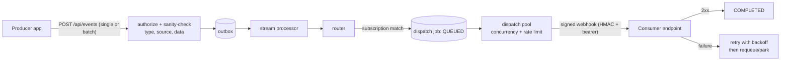

# Messaging & Delivery

The messaging core moves a business event from a producer's database
commit to a consumer's webhook endpoint with at-least-once delivery,
ordering within a group, and operator visibility at every hop.

## The pipeline

- **Event types** (`evt_…`) are registered per application (usually synced
  from the SDK) and may carry JSON schemas. The schemas are
  documentation for consumers: ingestion does **not** check an event
  against its registered event type or schema. It checks the caller's
  permission, that `type`, `source` and `data` are present, that an
  application-scoped credential only publishes types belonging to its own
  application (`<application-code>:` prefix) and that the caller has
  access to the client, and that the data is no larger than the largest
  payload (see [Payloads](#payloads)). An event whose type is not registered is still
  stored as a fact; it simply matches no subscription, so nothing is
  delivered for it.
- **The outbox** decouples ingestion from processing: accepting an event
  and processing it are separate, restart-safe steps. Producer apps using
  the SDKs get the same pattern on their side — events are written with
  their local transaction and relayed afterwards, so a crash never loses
  or double-invents an event. The relay never gives up on a row the
  platform could not take (an outage, a timeout, a 5xx): it retries with a
  backoff of up to 5 minutes, keeping order within a message group. A row
  the platform refuses (400, 403, or an item answered `BAD_REQUEST`, such as
  `PAYLOAD_TOO_LARGE`) stays failed and stops its message group until an
  operator retries or skips it, across restarts. The relay sends its rows in
  requests of at most 8 MiB by default, and splits a request the platform
  answers `413` (too large); a single row the platform will not take in a
  request of its own is refused the same way, as `PAYLOAD_TOO_LARGE`.
- **The stream processor** moves accepted events forward and hands them to
  the router. In multi-instance deployments the processors are
  leader-gated so per-group ordering (FIFO within a message group) holds.
- **The router** evaluates **subscriptions** — bindings from event types
  to consumer endpoints/queues — and materialises a **dispatch job** per
  delivery. Requeue storms are deduplicated at route time, so re-driving a
  backlog cannot create duplicate deliveries.

## Delivery

- **Dispatch pools** bound delivery: each pool sets concurrency and rate
  limits, so one slow or flooded consumer cannot starve the rest.
- Webhooks authenticate two ways at once: a bearer **auth token** and an
  HMAC-SHA256 **signing secret** (both per service account, rotatable from
  the admin UI — shown once on rotation).
- The account that signs a delivery is the subscription's own, else its
  connection's, else the application's. Naming one — on a subscription, a
  connection or a scheduled job — is allowed only to a user who may use that
  account: an administrator with platform-wide reach may use any, anyone else
  only an account linked to clients they can all access. The same applies to
  changing the URL of work an account signs. Previewing a signed delivery
  (the **Sign** action on a dispatch job) is likewise limited to
  platform-wide administrators.
- Failures retry with backoff under the poller's control; jobs that keep
  failing are parked for operator attention rather than retried forever.
  The admin UI supports inspection, single and **bulk requeue**.
- **Time window.** Every dispatch-job *list* read (`GET /api/dispatch-jobs`,
  `/list-raw`, `/filter-options`, and the requeue-by-filter preview and run) is
  held to a `created_at` window. Send `since` / `until` (RFC 3339) to choose it;
  send neither and the **last 24 hours** are read, and the answer says so (the
  list's `X-Window-From`, `X-Window-To` and `X-Window-Defaulted` response headers;
  a `window {from, to, defaulted}` object in the filter-options, preview and
  requeue-by-filter bodies). A window wider than the maximum (31 days by default;
  `FC_DISPATCH_JOB_MAX_WINDOW_DAYS`) is `400 WINDOW_TOO_LARGE`. Lookups keyed by
  one job or one event are not windowed: by id, by event id, attempts, sign.
- **Filtering by event type, subscription and connection.** A dispatch job's
  `code` is its event type for a job an event raised, and the caller's own job
  code for a job created through the API or a function's `fn.dispatch`. The list
  (and the same filter on `/list-raw` and in the
  requeue-by-filter preview and run bodies) filters on it with `eventType` (one) and
  `eventTypes` (comma-separated, at most 10) alongside the older `code` / `codes`.
  Subscriptions: `subscriptionId`, `subscriptionIds` (at most 50),
  `subscriptionCode` and `subscriptionName` (exact; a trailing `*` makes it a
  prefix; name is case-insensitive). Connections: `connectionId`, `connectionCode`
  (a connection's jobs are those of its subscriptions plus jobs that name the
  connection themselves). Names and codes are looked up first, within the
  caller's own tenants, and the job query is then a plain id match: a name that
  matches nothing returns an empty list, a name that matches more than 200
  subscriptions (50 connections) is `400 TOO_MANY_MATCHES`. All filters combine
  (each must hold) and stay inside the time window. `filter-options` lists
  `eventTypes` (= `codes`) from the jobs of the window; it is cached for a minute
  per tenant scope and window.
- **What a requeue will and will not reset.** Requeue (by ids, by filter, or one
  job) resets `PENDING`, `FAILED`, `CANCELLED` and `EXPIRED` jobs to `PENDING`.
  A `QUEUED` or `PROCESSING` job is in flight and is **never** reset — it is
  skipped and reported (`skippedInFlight`; per job `reason: IN_FLIGHT` when
  requeueing by ids), not an error for the batch. A `COMPLETED` job is
  re-delivered only by an explicit **redrive**: the request sets
  `redriveCompleted: true` *and* `confirmRedriveCompleted: "REDRIVE"` (and the
  caller holds `dispatch-job:redrive-completed`); without both, completed jobs
  are skipped and reported (`skippedCompleted`: "completed jobs are redriven only
  with redriveCompleted and confirmRedriveCompleted"). The preview reports
  `completedCount` and `inFlightCount` apart from `eligibleCount`, and
  `redriveEligibleCount` (the `confirmCount` of a request that also redrives). A
  redrive is recorded as such in the audit row, whose operation JSON
  carries `redriveCompleted: true`.
- **Permissions.** Reading stays `platform:messaging:dispatch-job:view`. Each
  write has its own permission: `dispatch-job:requeue` (requeue by ids or by
  filter, and its preview), `dispatch-job:redrive-completed` (additionally needed
  by a request that sets `redriveCompleted`; never implied by anything else),
  `dispatch-job:cancel`, `dispatch-job:complete`, `dispatch-job:edit-payload`.
  Roles that held `view` before the split were granted the first, third, fourth
  and fifth by an upgrade migration (not the read-only `platform:viewer`);
  `redrive-completed` is granted to no one automatically. Tokens carry their
  permissions from mint time, so a user signs in again to pick the grants up.
- **Edit payload.** An operator can correct a bad payload on a job that is
  `PENDING` or `FAILED` (`PUT /api/dispatch-jobs/{id}/payload`, body
  `{payload, payloadContentType?}`; the job drawer's pencil in the console, "Edit
  payload…" in the server-rendered UI), then requeue it. The edit changes the
  payload (UTF-8, at most the largest payload the deployment accepts, see
  [Payloads](#payloads); valid JSON when the content type is JSON) and
  optionally the content type — never the status or attempts. A `QUEUED` or
  `PROCESSING` job is being delivered and a `COMPLETED` / `CANCELLED` / `EXPIRED`
  one is history: both answer `409 NOT_EDITABLE`. It needs `dispatch-job:edit-payload`
  and honours the job's client scope. An edited job gets a payload of its own;
  the event and the other jobs it raised keep the original. The audit event
  (`platform:messaging:dispatch-job:payload-edited`) records sizes and SHA-256
  digests of the old and new payload, not the payload, and, where the payloads
  are stored as payload rows, the ids of the old and new row
  (`previousPayloadId`, `payloadId`). Editing a job whose payload is missing
  from the payload store is how that job is repaired: the old digest is then
  empty. When the payload store cannot be read or written the edit is refused
  with `500 PAYLOAD_STORE_UNAVAILABLE`; try again.
- Job lifecycle is visible end to end: QUEUED → PROCESSING → COMPLETED /
  DELIVERY_FAILED, with raw payload debugging for administrators holding
  the view-raw permission.

## The delivery body

A dispatch job is delivered to its target as a signed `POST`. Two shapes, chosen
by the job's `dataOnly` flag:

**The envelope** (the default, `dataOnly` false) is JSON, sent with
`Content-Type: application/json`:

| Field | Meaning |
|---|---|
| `id` | The dispatch job's id |
| `type` | The job's code (the event type, for a job an event raised) |
| `attemptNumber` | 1 for the first delivery, then 2, 3, … |
| `time` | When the job was created: UTC, RFC 3339 with milliseconds (`2026-10-31T09:15:02.481Z`) |
| `dataContentType` | The content type of the payload, when the job has one (an ingestion's record: its split's type, or for an unsplit HTTP payload the caller's `Content-Type`) |
| `source`, `subject`, `correlationId`, `messageGroup` | Present when the job has them |
| `clientId`, `clientCode` | The job's client; `clientCode` (the identifier slug) is left out when the client cannot be resolved |
| `data` | The payload: parsed JSON when it parses, else the text as a string |

**Data only** (`dataOnly` true) sends the payload **byte for byte, with no
envelope**. Its `Content-Type` is the **job's own content type** (`application/json`
when it has none), so a job made with `application/xml` reaches the target as XML. What
the envelope would have carried arrives in headers instead: `X-Dispatch-Job-Id`,
`X-Event-Type` (the job's code) and `X-FlowCatalyst-Client: {clientId}:{clientCode}`
(left out when the job has no resolvable client).

Both are signed the same way (`X-FlowCatalyst-Signature` over timestamp plus body, with
`X-FlowCatalyst-Timestamp`); the signature covers the body alone.

For a payload stored as a payload row (see [Payloads](#payloads)), a data-only delivery is
the **producer's bytes** exactly as they were sent: key order, spacing and repeated keys
included. Before, an event's data was stored as parsed JSON, so a data-only delivery
carried the database's rendering of it (keys re-ordered, a repeated key dropped). An
envelope delivery is built by parsing the payload either way, so its shape is unchanged.

## Payloads

The payload of an event or a dispatch job is stored once, as the text the producer sent, in
a payload table of its own. The event and every job it raises point at that one row; a job
created directly (the API, a function's dispatch, an ingestion) and an edited job have a row
of their own. A large deployment can also configure a **payload store** (an S3 bucket, or a
directory): a payload larger than a threshold (5 KiB by default) is then kept there,
compressed, and its row holds only where it is. A subscriber always receives the whole
payload; nothing about the store ever leaves the platform.

Both are switched on per deployment by the operator (`FC_PAYLOAD_TABLE_WRITES`, then
optionally `FC_PAYLOAD_STORE`; the environment variable reference says how and in which
order). Until then payloads are stored as before. Payloads are kept as long as the events
and jobs that point at them, and dropped with them.

**The largest payload** an event's data or a job's payload may be:

| Deployment | Largest payload |
|---|---|
| No payload store, or the payload table not written | 1 MiB (`FC_PAYLOAD_INLINE_MAX_BYTES`) |
| A payload store, the payload table written and a threshold that is not 0 | 5 MB (`FC_PAYLOAD_MAX_BYTES`), so that a delivery in its envelope still fits a receiver's 5 MiB limit |

A request that carries one payload may be up to twice that plus 64 KiB (escaping can
nearly double a payload sent as a JSON string); a batch request up to 16 MiB
(`FC_INGEST_BATCH_MAX_BYTES`). A larger request is refused whole, `413 BODY_TOO_LARGE`. A
receiver subscribed to large payloads must accept a body of that size.

**What a payload is refused or fails with:**

| Code | Where | Meaning |
|---|---|---|
| `PAYLOAD_TOO_LARGE` | `400` on a single route; a batch item's `BAD_REQUEST` | Larger than the largest payload. Permanent: send it smaller. |
| `PAYLOAD_NOT_TEXT` | `400` on a single route; a batch item's `BAD_REQUEST` | Not UTF-8 text, or it holds a NUL byte. Permanent. |
| `PAYLOAD_STORE_UNAVAILABLE` | `503` on a single route; a batch item's `INTERNAL_ERROR` | The payload store could not be written and the payload is too large to keep in the database. Send it again later; the outbox relay does so by itself. |
| `PAYLOAD_MISSING` | A dispatch job's last error | The job's stored payload is gone or does not match what was stored. The job is `FAILED` without an attempt and is not retried; edit its payload and requeue it, or cancel it. |

On a batch route each item is answered in its own result slot and the others are stored.
When the payload store cannot be written, a payload the database can hold (up to 1 MiB) is
kept in the database instead, so ingestion goes on. When the store cannot be read at
delivery time the job is simply delivered later: no attempt is spent.

**What a read returns.** A list never fetches a payload from the payload store:

- Events (`GET /api/events` and its console views) carry `dataSize` (bytes); data kept in
  the store is left out, with `dataOffloaded: true`. The event's own route returns it.
- The dispatch-job debug list carries `payloadLength` and never the payload.

A read of one event or one job returns the payload, read from the store when it is there.
When it cannot be read the record is still returned, without it: `dataUnavailable: true`
on an event, `payloadUnavailable: true` on a job. The **Sign** action answers
`409 PAYLOAD_MISSING` or, when the store cannot be read, `500 PAYLOAD_UNAVAILABLE`.

## Ordering, delay and age

- **Ordering is per subscriber.** Events that share a `messageGroup` are delivered in order
  to each subscription separately. Under `BLOCK_ON_ERROR`, a failed delivery holds that
  subscription's later events of the group until the failure is resolved; other
  subscriptions of the same events keep receiving them. The envelope's `messageGroup` is
  the event's own group.
- **`delaySeconds`** on a subscription holds each delivery until that many seconds after
  the event was ingested. **`maxAgeSeconds`** (24 hours unless set) is the limit: a delivery
  not made within that time of the event is not made — the dispatch job becomes
  `EXPIRED`. Both are fixed when the event arrives; editing the subscription affects later
  events only. A requeued job is delivered regardless of its age.
- **Retries** follow the job's `retryStrategy`: `exponential` (the default: 5 s, 15 s, 30 s,
  60 s, then every 120 s), `fixed` (every 30 s) or `immediate`.
- **A subscriber can say when to come back:** a 2xx `{"ack": false, "notBefore":
  "<RFC 3339>"}` (or `delaySeconds`), or a 429 with `Retry-After` in seconds or as a date.
  None of these spends a retry.
- **Dispatch pools:** a `SUSPENDED` pool's jobs wait until it is resumed; an `ARCHIVED`
  pool takes no new jobs or subscriptions (`409 POOL_ARCHIVED`), and its existing jobs
  wait.
- **Event-type filters** on a subscription are not supported; a binding receives every
  event of its type (a non-empty `filter` is refused).
- A subscription created without `dataOnly` is delivered **the envelope**.

## Scheduled jobs

Cron-driven work lives in **scheduled jobs** (`sjb_…`): 6-field cron
expressions only (seconds first: `sec min hour day-of-month month day-of-week`;
5- and 7-field forms are rejected when saved, since they would never fire),
signed delivery to the target (bearer + HMAC, like webhooks), instance
tracking with logs, and retention policies. Applications register their
own scheduled jobs through the SDK; the admin UI can pause, fire manually,
and inspect instances. An application's service account (the
`platform:application-service` role, permission `scheduled-job:fire`) can look up
and fire the scheduled jobs of its own application only.

How firing behaves:

- **One firing per tick.** Each (job, scheduled tick) is claimed in the
  database before an instance is created, so a tick fires once even if two
  platform nodes both believe they are the leader. Ticks missed during downtime
  are skipped: only the latest missed tick fires on recovery.
- **Timing.** The scheduler sleeps until the next due tick, so schedules faster
  than 30 seconds (down to one second) fire on time.
- **Concurrency is the receiver's job.** The job's `concurrent` flag is sent to
  the receiver in the firing envelope but the platform does not enforce it: it
  fires every tick regardless of earlier runs. A receiver that must not overlap
  runs enforces that itself (the SDK runners do, when `concurrent` is false).
- **Timeout.** The platform's HTTP call to the target uses the job's
  `timeoutSeconds` (default 10 seconds, at most 300). The same value is sent to
  the receiver.
- **Delivery and failures.** Any 2xx response means delivered; other responses
  are retried up to the job's delivery max attempts, then the instance is
  `DELIVERY_FAILED`. Completion is acknowledged by the consumer; an instance
  that never acks stays visible as running rather than silently vanishing.
- **Crash recovery never re-fires.** An instance left `IN_FLIGHT` by a platform
  crash is, after the call timeout plus a margin (6 minutes by default), marked
  `DELIVERY_FAILED` with an `ABANDONED` reason and an error log entry. It is not
  sent again, because the receiver may already have received it.

## Processes

**Processes** (`prc_…`) are multi-step definitions — diagrams (Mermaid or
structured), steps, and per-instance logs — synced from application code
and visible in the admin UI. They document and track long-running business
flows that span multiple events.

## Operational surfaces

- **Events** and **dispatch jobs** list pages with filtering by
  application, type, and status.
- **Audit log** for administrative changes; **login attempts** for the
  identity plane.
- Batch ingestion endpoints for events, dispatch jobs, and audit logs
  (positional results — one result per submitted item).
