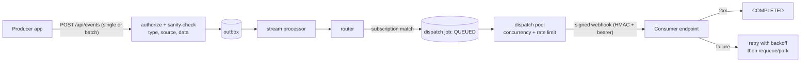

# Messaging & Delivery

The messaging core moves a business event from a producer's database
commit to a consumer's webhook endpoint with at-least-once delivery,
ordering within a group, and operator visibility at every hop.

## The pipeline

- **Event types** (`evt_…`) are registered per application (usually synced
  from the SDK) and may carry JSON schemas. The schemas are
  documentation for consumers: ingestion does **not** check an event
  against its registered event type or schema. It checks the caller's
  permission, that `type`, `source` and `data` are present, that an
  application-scoped credential only publishes types belonging to its own
  application (`<application-code>:` prefix) and that the caller has
  access to the client. An event whose type is not registered is still
  stored as a fact; it simply matches no subscription, so nothing is
  delivered for it.
- **The outbox** decouples ingestion from processing: accepting an event
  and processing it are separate, restart-safe steps. Producer apps using
  the SDKs get the same pattern on their side — events are written with
  their local transaction and relayed afterwards, so a crash never loses
  or double-invents an event.
- **The stream processor** moves accepted events forward and hands them to
  the router. In multi-instance deployments the processors are
  leader-gated so per-group ordering (FIFO within a message group) holds.
- **The router** evaluates **subscriptions** — bindings from event types
  to consumer endpoints/queues — and materialises a **dispatch job** per
  delivery. Requeue storms are deduplicated at route time, so re-driving a
  backlog cannot create duplicate deliveries.

## Delivery

- **Dispatch pools** bound delivery: each pool sets concurrency and rate
  limits, so one slow or flooded consumer cannot starve the rest.
- Webhooks authenticate two ways at once: a bearer **auth token** and an
  HMAC-SHA256 **signing secret** (both per service account, rotatable from
  the admin UI — shown once on rotation).
- Failures retry with backoff under the poller's control; jobs that keep
  failing are parked for operator attention rather than retried forever.
  The admin UI supports inspection, single and **bulk requeue**.
- **Time window.** Every dispatch-job *list* read (`GET /api/dispatch-jobs`,
  `/list-raw`, `/filter-options`, and the requeue-by-filter preview and run) is
  held to a `created_at` window. Send `since` / `until` (RFC 3339) to choose it;
  send neither and the **last 24 hours** are read, and the answer says so (the
  list's `X-Window-From`, `X-Window-To` and `X-Window-Defaulted` response headers;
  a `window {from, to, defaulted}` object in the filter-options, preview and
  requeue-by-filter bodies). A window wider than the maximum (31 days by default;
  `FC_DISPATCH_JOB_MAX_WINDOW_DAYS`) is `400 WINDOW_TOO_LARGE`. Lookups keyed by
  one job or one event are not windowed: by id, by event id, attempts, sign.
- **Filtering by event type, subscription and connection.** A dispatch job's
  `code` is its event type for a job an event raised, and the caller's own job
  code for a job created through the API or a function's `fn.dispatch`. The list
  (and the same filter on `/list-raw` and in the
  requeue-by-filter preview and run bodies) filters on it with `eventType` (one) and
  `eventTypes` (comma-separated, at most 10) alongside the older `code` / `codes`.
  Subscriptions: `subscriptionId`, `subscriptionIds` (at most 50),
  `subscriptionCode` and `subscriptionName` (exact; a trailing `*` makes it a
  prefix; name is case-insensitive). Connections: `connectionId`, `connectionCode`
  (a connection's jobs are those of its subscriptions plus jobs that name the
  connection themselves). Names and codes are looked up first, within the
  caller's own tenants, and the job query is then a plain id match: a name that
  matches nothing returns an empty list, a name that matches more than 200
  subscriptions (50 connections) is `400 TOO_MANY_MATCHES`. All filters combine
  (each must hold) and stay inside the time window. `filter-options` lists
  `eventTypes` (= `codes`) from the jobs of the window; it is cached for a minute
  per tenant scope and window.
- **What a requeue will and will not reset.** Requeue (by ids, by filter, or one
  job) resets `PENDING`, `FAILED`, `CANCELLED` and `EXPIRED` jobs to `PENDING`.
  A `QUEUED` or `PROCESSING` job is in flight and is **never** reset — it is
  skipped and reported (`skippedInFlight`; per job `reason: IN_FLIGHT` when
  requeueing by ids), not an error for the batch. A `COMPLETED` job is
  re-delivered only by an explicit **redrive**: the request sets
  `redriveCompleted: true` *and* `confirmRedriveCompleted: "REDRIVE"` (and the
  caller holds `dispatch-job:redrive-completed`); without both, completed jobs
  are skipped and reported (`skippedCompleted`: "completed jobs are redriven only
  with redriveCompleted and confirmRedriveCompleted"). The preview reports
  `completedCount` and `inFlightCount` apart from `eligibleCount`, and
  `redriveEligibleCount` (the `confirmCount` of a request that also redrives). A
  redrive is recorded as such: the event `platform:messaging:dispatch-jobs:resent`
  carries `redrive: true` and `redrivenCount`, and the audit row's operation JSON
  carries `redriveCompleted: true`.
- **Permissions.** Reading stays `platform:messaging:dispatch-job:view`. Each
  write has its own permission: `dispatch-job:requeue` (requeue by ids or by
  filter, and its preview), `dispatch-job:redrive-completed` (additionally needed
  by a request that sets `redriveCompleted`; never implied by anything else),
  `dispatch-job:cancel`, `dispatch-job:complete`, `dispatch-job:edit-payload`.
  Roles that held `view` before the split were granted the first, third, fourth
  and fifth by an upgrade migration (not the read-only `platform:viewer`);
  `redrive-completed` is granted to no one automatically. Tokens carry their
  permissions from mint time, so a user signs in again to pick the grants up.
- **Edit payload.** An operator can correct a bad payload on a job that is
  `PENDING` or `FAILED` (`PUT /api/dispatch-jobs/{id}/payload`, body
  `{payload, payloadContentType?}`; the job drawer's pencil in the console, "Edit
  payload…" in the server-rendered UI), then requeue it. The edit changes the
  payload (UTF-8, at most 256 KiB, valid JSON when the content type is JSON) and
  optionally the content type — never the status or attempts. A `QUEUED` or
  `PROCESSING` job is being delivered and a `COMPLETED` / `CANCELLED` / `EXPIRED`
  one is history: both answer `409 NOT_EDITABLE`. It needs `dispatch-job:edit-payload`
  and honours the job's client scope. The audit event
  (`platform:messaging:dispatch-job:payload-edited`) records sizes and SHA-256
  digests of the old and new payload, not the payload.
- Job lifecycle is visible end to end: QUEUED → PROCESSING → COMPLETED /
  DELIVERY_FAILED, with raw payload debugging for administrators holding
  the view-raw permission.

## Scheduled jobs

Cron-driven work lives in **scheduled jobs** (`sjb_…`): 6-field cron
expressions (seconds first: `sec min hour day-of-month month day-of-week`), locking so exactly one instance fires per tick even in HA,
signed delivery to the target (bearer + HMAC, like webhooks), instance
tracking with logs, and retention policies. Applications register their
own scheduled jobs through the SDK; the admin UI can pause, fire manually,
and inspect instances. Completion is acknowledged by the consumer; an
instance that never acks stays visible as running rather than silently
vanishing.

## Processes

**Processes** (`prc_…`) are multi-step definitions — diagrams (Mermaid or
structured), steps, and per-instance logs — synced from application code
and visible in the admin UI. They document and track long-running business
flows that span multiple events.

## Operational surfaces

- **Events** and **dispatch jobs** list pages with filtering by
  application, type, and status.
- **Audit log** for administrative changes; **login attempts** for the
  identity plane.
- Batch ingestion endpoints for events, dispatch jobs, and audit logs
  (positional results — one result per submitted item).
